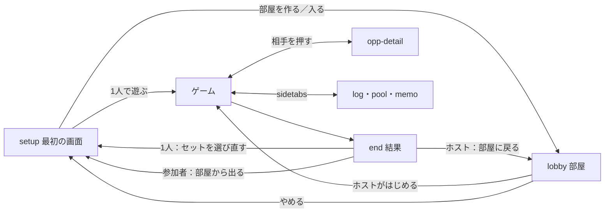
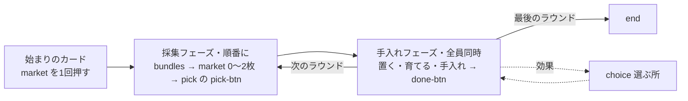

# Gateway Garden UIまとめ

画面の呼び名・配置・行き来・よくやる操作の手数をまとめる。画面を直す指示は、ここの **ID** で言えば短くなる（例：「`action` の終えるボタンを下に固定」）。
中身や画面を足したら、同じコミットでここも直す。

- 測った版：0.14.1（遊び方のタブ・流れの図を足した。投了のタブを足した。2026-11-23、工程9 の game-ui の判定 D1〜D5、E・F の直し、お題の順位の枠、挿絵（夜空の島）とエフェクトを入れた）。画面の大きさは 1920×1080（ブラウザの中 1920×950）。
- 位置と大きさは、実際の画面で測った数字（`getBoundingClientRect`）。

## 1. 呼び名の表

ID はコードのクラス名（`.a-xxx` など）に合わせた。

### ゲームの画面

| ID | 呼び名 | 場所・大きさ | 役目 | コード |
|---|---|---|---|---|
| `topbar` | 上の帯 | いちばん上・高さ47 | ラウンドと相手 | `header.topbar` |
| `round` | ラウンドの欄 | 上の帯の左（幅1215） | ラウンド○/○・フェーズ・摘む順（今の人を色付け）・次の先番・部屋の合言葉 | `.tb-round` |
| `opps` | 相手の欄 | 上の帯の右（幅623） | 相手1人につき1行：名前・魔素・手元の枚数・考え中／終えた・点。押すと `opp-detail` | `.tb-opps` `.opp-box` |
| `bundles` | 束 | 真ん中の段の左（幅は束の数しだい、2人で206×194） | 束は1つを縦にして横に並べる（名前なし）。押して選ぶ。中の魔素は入れ替えで押す | `.a-bundles` |
| `market` | 場のカード | 束の右（890×194）。右は空けてある（挿絵の場所） | 6枚。カードは庭と同じ 138×168。押して招く（2枚まで、押した順に1・2）。世界はカードの役目の行に略（例：号令） | `.a-market` |
| `goals` | お題カード（立て札） | 下の段の左（幅250、入る分だけの高さ）。手元の早見表として | 3枚。順位の枠（1位5点・2位3点・3位1点）を縦に並べ、満たした人の名前が入る。今満たすと入る枠が光る | `.a-goals` `.goal-slots` |
| `garden` | 自分の庭 | 下の段の左から2つ目（472×635） | 点・魔素（上限・合計）・3×3のマス | `.a-garden` |
| `action` | あなたのすること | 庭のすぐ右（下の段の残り全部） | 今できること・払い・手元のカード・選ぶ所。摘む・終える・戻すボタンは欄の下に固定 | `.a-action` |
| `card-tip` | カードの説明 | マウスを乗せたカードのすぐ横に浮かぶ（幅340） | ★ごとの効果・色・役目・値段・世界の名前（全文） | `.card-tip` |
| `sidetabs` | 右のふちのタブ | 右のふち（幅35） | 遊び方（ゲームの流れの図とルール。src/ui/rules.js、はじめの画面・部屋・カードの一覧と同じ）・できごと・カードの一覧・メモ・投了（1人：セットの選択へ／ホスト：全員を部屋へ／入った人：席を CPU に任せて部屋から出る）・動きを減らす（光るだけにする）・記録をコピー | `nav.sidetabs` |
| `fx-layer` | エフェクトの層 | 画面全体の上（押せない） | 摘んだ魔素・招いたカードが飛ぶ、門から新しいカード、置いた・RANK UP・開花・お題を取った・ラウンドの札・あなたの番。描き直しで消えない。`src/ui/fx.js` | `#fx-layer` |

### `action` の中の部品

| ID | 呼び名 | 出るとき |
|---|---|---|
| `pick-btn` | 摘むボタン | 採集フェーズの自分の番。`action` の下に固定 |
| `pay-chips` | 好きな色の払い | 招くカードの値段に「好きな色」があるとき。押すと色が変わる |
| `swap` | 入れ替え | 入れ替えの導きカードがあるとき。`bundles` の欄の下（`.swap-box`） |
| `pending` | 手元のカード | 招いた後（採集フェーズでもカードの形で見せる）。手入れフェーズでは招いて、まだ置いていないカード。庭のマスへドラッグして置く（押して選び、マスを押しても置ける） |
| `grow-btn` | 育てるボタン・手入れボタン | 手入れフェーズで庭のカードを選んだとき。そのカードの下の方に重ねて出る（`.cell-bar`） |
| `done-btn` | このラウンドを終える（開花） | 手入れフェーズ。`action` の下に固定（位置が動かない） |
| `undo-btn` | 1つ戻す | 手入れフェーズ・選ぶ所。`action` の下に固定 |
| `choice` | 選ぶ所 | 効果で選ぶとき（好きな色・色を変える・★を育てる・動かす・捨てる） |

### 重なる画面（overlay）

| ID | 呼び名 | 開く | 閉じる |
|---|---|---|---|
| `opp-detail` | 相手の庭 | `opps` の相手を押す | 閉じる・外を押す |
| `log` | できごと | `sidetabs` | 閉じる・外を押す |
| `pool` | カードの一覧 | `sidetabs` | 閉じる |
| `memo` | メモ（落書き） | `sidetabs` | もう一度押す |
| `end` | 結果 | ゲームの終わりに自動 | 部屋に戻る・セットを選び直す |

### ゲームの外

| ID | 呼び名 | 役目 |
|---|---|---|
| `setup` | 最初の画面 | タブ（1人で遊ぶ・部屋を作る・部屋に入る）、名前・人数・長さ・世界・種 |
| `lobby` | 部屋（待合室） | 合言葉・席・ゲームセット（ホストだけ選べる）・はじめる |

## 2. 配置の図（ゲームの画面）

箱の中は ID だけ（日本語は幅がずれるので）。数字は px。

```
x0                                                                              x1920
┌─ topbar (h47) ────────────────────────────────────────────────────────────────┐
│ round                                                    │ opps              │
├─────────┬──────────────────────────────────────────────────────────┐         │ y61
│ bundles │ market                                                   │         │
│ 220     │ （世界は役目の行に略）                                   │         │
│ swap    │                                                          │         │ y267
├─────────┴─┬───────────────────┬──────────────────────────────────────┤  ┌──┐   │ y281
│ goals     │ garden            │ action                               │  │si│   │
│ 250       │ 472               │                                      │  │de│   │
│           │ score / mana      │                                      │  │ta│   │
│           │ ┌───┬───┬───┐     │                                      │  │bs│   │
│           │ │ 1 │ 2 │ 3 │     │                                      │  └──┘   │
│           │ ├───┼───┼───┤     │                                      │         │
│           │ │ 4 │[育てる]│     │                                      │         │
│           │ ├───┼───┼───┤     │                                      │         │
│           │ │ 7 │ 8 │ 9 │     │ ─ pick-btn／done-btn・undo-btn（固定）│         │
│           │ └───┴───┴───┘     │                                      │         │ y916
└───────────┴───────────────────┴──────────────────────────────────────┘         │
 card-tip：マウスを乗せたカードのすぐ横に浮かぶ
```

## 3. 行き来の図

### 画面



### ゲームの流れ（`action` に出るもの）



## 4. よくやる操作の手数

回数は自動対戦（CPU かしこい・基本セット・3人・8ラウンド・200ゲーム）の **1人あたり1ゲームの平均**。手数は今の画面で押す回数（マウスを乗せるだけは数えない）。

| 操作 | 回数 | 押す所（手数） | 頻度×手数 |
|---|---|---|---|
| 育てる | 12.4 | `garden` のカード → その下の `grow-btn`（2、63px）。続けて育てるときは選んだままなので1。2回押しでも育つ | **約15** |
| 摘む（招く0〜2枚） | 8.0 | `bundles` → `market` ×0〜2 → `pick-btn`（2〜4、平均3.0） | **24.0** |
| 手元のカードを置く | 9.0 | `pending` を `garden` の空きマスへドラッグ（1） | **9.0** |
| 好きな色を1つ得る | 9.0 | `choice` の色（1） | 9.0 |
| 色を変える・動かす | 5.6 | `choice`（1〜2） | 約8 |
| ラウンドを終える | 8.0 | `done-btn`（1） | 8.0 |
| 変えない・動かさない | 5.5 | `choice`（1） | 5.5 |
| あふれた魔素を捨てる | 1.8 | 捨てる ×個数 → 決める（約3） | 約5 |
| 始まりのカード | 1.0 | `market`（1） | 1.0 |
| **合計** | | | **約85回押す**（工程9 の前は約104回）。摘むの移動は1回 1516px → 1181px |

ほかに、回数は測れないが多い操作：カードにマウスを乗せて `detail` を読む。

### 気づいたこと（工程9 で直した：0.10.0）

人の判定：1〜6 は直す。お題カードは手元の早見表として左下へ。直し方：
1. 育てた後もマスを選んだまま（案A）＋同じカードを素早く2回押すと育てる（案B。右クリックは見つけにくいので2回押し）。
2. 手元のカードが1枚だけなら、はじめから選んでおく。庭のカードを押したら選びは外れる（育てたいときに置いてしまわない）。庭が埋まっているとき（置き換え）は選ばない。
3・4. `action` と `detail` を庭のすぐ右に、上下に重ねた。お題を左下に移したので `garden` は左から2つ目。
5. 終える・戻すボタンを `action` の下に固定（中身だけがスクロールする）。
6. 摘む操作（束・場のカード・払い・摘むボタン）を上の段の `pick` の欄にまとめた。上と下の往復がなくなった。

2回目（0.11.0、game-ui の採点と判定 D1〜D5、Claude Docs「Gateway Garden 工程9 画面と挿絵」）：
- D1 カードの説明は、マウスを乗せたカードのすぐ横に浮かぶ（`card-tip`）。カード→説明は 995〜1132px → 248〜310px。右下の説明の欄はなくした。
- D2 庭のカードを押すと、そのカードの下の方に育てる・手入れが出る（`.cell-bar`、34px）。カード→育てるは 563px → 63px。2回押しも残した。
- D3 手元のカードは庭のマスへドラッグ＆ドロップ。運んでいる間は置けるマスが点線で光り、画面は描き直さない。「はじめから選ぶ」はやめた（分かりづらい）。
- D4 摘むの欄はなくし、払いと摘むボタンは `action` の下に固定（ずれ 51px → 0px）。入れ替えは `bundles` の欄の下。
- D5 世界はカードの役目の行に2文字の略（拡張の expansion.json の `short`。なければ名前の先頭2文字）。全文は `card-tip`。11px 未満の文字は 7 → 0。

もとの気づき（記録）：

1. **育てるが一番多い。** 育てると選びが消える（画面で確かめた）ので、同じカードをもう1段育てるときも、マスから押し直す（★★★まで育てると4手）。
   - 案A：育てた後もそのマスを選んだままにする → 続けて育てるのは1手。
   - 案B：マスを右クリック（またはダブルクリック）で、すぐ育てる → いつも1手。約12手減る。
2. **置くのは2手。** 手元のカードが1枚だけのときは、はじめから選んでおけば、マスを押す1手で済む。約5手減る。
3. **目の動きが遠い。** `garden`（左のはし）のカードにマウスを乗せると、説明は `detail`（右のはし、約1000px先）に出る。庭を見ながら説明を読みにくい。`detail` を `garden` のすぐ右に置くか、カードの近くに小さく出す案。
4. **`action` が広い。** 幅1008あって、たいていは数行しか入っていない。一方で `garden` は472。庭のまわりはエフェクトの場所として空けた（工程7）ので、そのままでよいかは人が決める。
5. **`done-btn` の高さが動く。** 手元のカードの列・選んだカードの行が出たり消えたりすると、その下にある終えるボタンが上下する（測ったら、置く前 y532 → 置いた後 y329 → 庭のカードを選ぶと y370）。aether で困った「押す場所がずれる」と同じ形。ボタンを `action` の下に固定する案。
6. **マウスの往復。** 摘む操作は `bundles`（左上）→ `market`（上の中央）→ `pick-btn`（下の段の中央）。毎ラウンド上と下を往復する。摘むボタンを場のカードの近くに置く案もある。

## 5. AI が読むための作り

- 押せる所には `data-act`（例：`data-act="bundle"`）、カードには `data-card`（id）と `data-stage` が付いている。ブラウザの道具で読むと、どこが押せるか分かる。
- 欄は `.a-bundles` などのクラスで探せる。1 の ID と同じ名前にそろえた `data-ui="bundles"` を付けると、もっと確実になる（まだ付けていない）。
- 盤面は HTML なので、canvas と違って文字で読める。ただし「今だれの番で、何を選べるか」は、画面のあちこちを読まないと分からない。`window.ggDescribe()`（今のフェーズ・自分の番か・選べる束とカード・押せるボタンを文字で返す）を作ると、AI の試し遊びと確かめが速くなる（まだ作っていない）。
